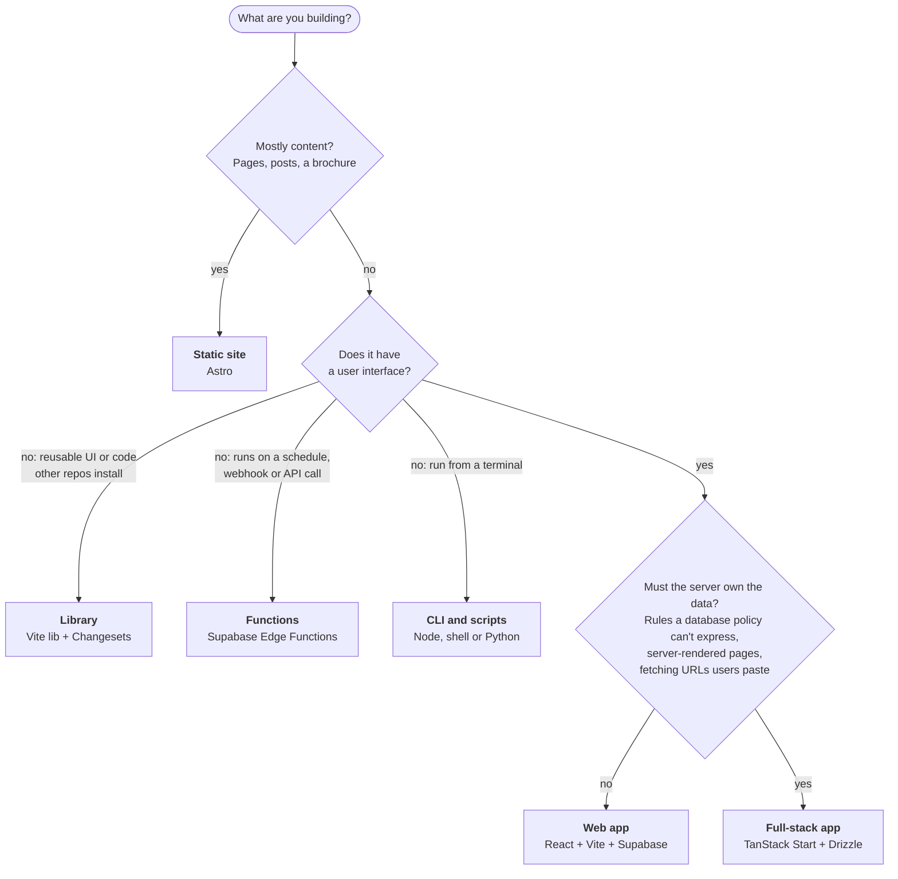

# Engineering Handbook

One standard for how Cloud 12Nine and Q-Labs projects are built: the stack, the workflow, the pipelines, and a kit of files to copy. It exists so that every repo looks the same from the outside, and a new developer or coding agent can start work without re-deciding anything.

**Agents:** read [`CLAUDE.md`](CLAUDE.md) first. A machine-readable index is in [`llms.txt`](llms.txt).

## Start here

| You want to… | Go to |
| --- | --- |
| Start a new project | [Pick a blueprint](blueprints/README.md), then [copy the kit](kit/README.md) |
| Know what tool we use for X | [The stack](standards/stack.md) |
| Know what every repo must contain | [Repo contract](standards/repo-contract.md) |
| Open an issue, branch, commit, PR | [Workflow](standards/workflow.md) |
| Write tests the way we do | [Testing](standards/testing.md) |
| Set up CI, previews, releases, hosting | [CI/CD](standards/ci-cd.md) |
| Add a table, a migration, auth | [Data](standards/data.md) |
| Handle a key, token or secret | [Security](standards/security.md) |
| Build UI | [UI and Cobalt](standards/ui.md) |
| Know what "good" means for a page | [Front-end checklist](standards/frontend-checklist.md) |
| Set up an agent or a cloud session | [Agents](standards/agents.md) |
| Bring an existing repo up to standard | [Adoption](adoption.md) |
| See what is still undecided | [Decisions](decisions.md) |

## What are you building?



| Blueprint | Use it for |
| --- | --- |
| [Static site](blueprints/static-site.md) | Marketing sites, portfolios, blogs |
| [Web app](blueprints/web-app.md) | Interactive apps with sign-in. The default |
| [Full-stack app](blueprints/full-stack-app.md) | Apps where the server must own the data |
| [Library](blueprints/library.md) | Packages other repos install, such as Cobalt |
| [Functions](blueprints/functions.md) | APIs, webhooks, scheduled jobs, model calls |
| [CLI and scripts](blueprints/cli-and-scripts.md) | Node tools, shell scripts, Python scripts |

Something else (mobile, browser extension, docs)? See [Not built yet](blueprints/other.md). How to choose between them: [Blueprints](blueprints/README.md).

## The standard on one page

| Layer | Standard |
| --- | --- |
| Language | TypeScript, strict mode |
| Runtime | Node 24 (LTS), npm |
| Content sites | Astro, static output |
| Apps | React + Vite. TanStack Start when the server must own the data |
| Design system | Cobalt (`@q-labs/cobalt`), with Tailwind v4 for layout |
| Backend | Supabase: Postgres, Auth, Edge Functions |
| Tests | Vitest, 100% coverage on all four metrics. Playwright for end-to-end |
| Lint | ESLint flat config, zero warnings |
| Front-end quality | The [Front-End Checklist](https://frontendchecklist.io): Critical and High rules required |
| Git hooks | husky: lint staged files on commit, typecheck and coverage on push |
| CI/CD | GitHub Actions builds. Netlify hosts. Netlify never builds |
| Releases | Version bumped in the PR, tagged on merge. Libraries use Changesets |
| Workflow | Issue first, test first (red, green, refactor), conventional commits |
| Agents | `CLAUDE.md` is the rulebook in every repo |

Details, reasons and status for each row: [The stack](standards/stack.md).

## How this repo is organised

```
standards/    The rules. One page per topic.
blueprints/   One page per kind of project: what to use and how to set it up.
kit/          Files to copy into a repo: workflows, hooks, configs, templates.
adoption.md   Where each existing repo stands, and the order to fix them in.
decisions.md  Every choice that still needs a yes or no.
CLAUDE.md     Rules for agents (and people) changing this handbook.
llms.txt      Index of every page, for agents.
index.html    The website viewer. It renders these same Markdown files.
```

The Markdown files are the source of truth. The website at <https://qiheme.github.io> only displays them.

## Starting a new project

1. **Pick the blueprint** with the chart above.
2. **Open the first issue** in the new repo: what you are building and which blueprint.
3. **Scaffold** with the command on the blueprint's page.
4. **Copy the kit**: follow the table in [`kit/README.md`](kit/README.md).
5. **Fill in `CLAUDE.md`** from the template. List anything that differs from the standard under "Deviations".
6. **Add the repo to [Adoption](adoption.md)** with a PR to this handbook.

## How to read a status

Every rule carries one of four labels.

| Label | Meaning |
| --- | --- |
| **Adopted** | Already how two or more active repos work. Follow it. |
| **In use** | One repo does it, and it works there. It is the standard for that kind of project until a second project confirms or changes it. |
| **Proposed** | A recommendation that no repo follows yet, or where the repos disagree. Follow it for new work; it is listed in [Decisions](decisions.md) for sign-off. |
| **Open** | Not decided. The page says who decides and where it is tracked. |

## Changing the standard

The standard changes by pull request to this repo, never by a repo quietly doing its own thing. See [`CLAUDE.md`](CLAUDE.md).

A repo may differ from the standard when it has a reason. The reason goes in that repo's `CLAUDE.md` under "Deviations", and in [Adoption](adoption.md).

> This repository is public. It holds no secrets and no internals of private projects, only stack-level facts. Keep it that way.
