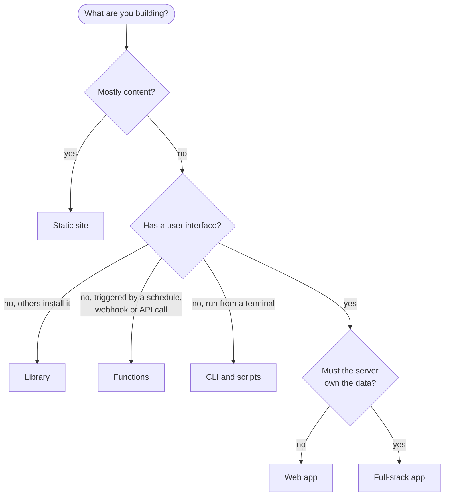

# Blueprints

A blueprint is the setup for one kind of project: what to use, how the folders are laid out, how it is tested and how it ships. Pick one before writing code.

## Pick one

| Blueprint | Use it when | Framework | Data | Host | Reference repo |
| --- | --- | --- | --- | --- | --- |
| [Static site](static-site.md) | Mostly content: marketing site, portfolio, blog, docs with pages | Astro | None, or content files | Netlify | `cloud129-site` (private), `portfolio` |
| [Web app](web-app.md) | An interactive app where a database policy can decide who sees what | React + Vite | Supabase from the browser, with RLS | Netlify | `easy-finances` (private), `Travel-OS` |
| [Full-stack app](full-stack-app.md) | The server must own the data, render pages, or fetch on the user's behalf | TanStack Start | Supabase Postgres through Drizzle, server-only | Netlify (not yet proven) | `wish-list` (private) |
| [Library](library.md) | Code other repos install: components, tokens, shared utilities | Vite library mode | None | GitHub Packages, Storybook on GitHub Pages | `cobalt` |
| [Functions](functions.md) | Server-side code with no interface of its own: APIs, webhooks, scheduled jobs, model calls | Supabase Edge Functions | Supabase | Supabase | `easy-finances` (private) |
| [CLI and scripts](cli-and-scripts.md) | Run from a terminal: Node tools, shell setup, Python scripts | Node, bash or Python | Varies | None | `easy-finances` scripts (private), `setup-scripts` (private) |
| [Not built yet](other.md) | Mobile app, browser extension, documentation site | See page | | | None |

## Web app or full-stack app?

This is the choice people get wrong. Default to **Web app**. It is less code and has a proven deploy pipeline.

Choose **Full-stack app** only if one of these is true:

| Signal | Example |
| --- | --- |
| A privacy rule is too important or too subtle for a database policy alone | One user must never learn what other users did with that user's own records |
| The server has to fetch things for the user | Reading a web page from a link someone pasted |
| Pages must be server-rendered | Share links that need previews and fast first paint for signed-out visitors |

A web app that only needs "a bit of server" (a webhook, a model call, a scheduled job) stays a web app and adds [Functions](functions.md).

## What every blueprint shares

All of them follow the [repo contract](../standards/repo-contract.md), the [workflow](../standards/workflow.md), and the [testing](../standards/testing.md) rules. The differences are the framework, the folder layout and the deploy target.

| | Static site | Web app | Full-stack app | Library | Functions | CLI |
| --- | --- | --- | --- | --- | --- | --- |
| TypeScript strict | ✓ | ✓ | ✓ | ✓ | ✓ | ✓ (Node) |
| Cobalt | tokens + components | ✓ | ✓ | is Cobalt | | |
| Tailwind | ✓ | ✓ | ✓ | no, CSS Modules | | |
| Vitest, 100% | on `src/lib/` | ✓ | ✓ | ✓ | ✓ | ✓ |
| Playwright | ✓ | ✓ | ✓ | Storybook | | |
| Storybook | | ✓ | ✓ | ✓ | | |
| JSDoc on exports | ✓ | ✓ | ✓ | | | |
| Preview per PR | ✓ | ✓ | ✓ | Storybook build | | |
| Release | version tag | version tag | version tag | Changesets | with its app | version tag |

## Combining blueprints

One repo can hold more than one. The common combinations:

- **Web app + Functions**: the app in `src/`, Edge Functions in `supabase/functions/`.
- **Web app + CLI**: tools in `scripts/<tool>/` that reuse the app's pure modules.
- **Static site + Functions**: a contact form handler or a scheduled rebuild.

Each part follows its own blueprint. One CI pipeline, one coverage report, one `CLAUDE.md`.

## Not on the list?

1. Start from the closest blueprint.
2. Keep the [repo contract](../standards/repo-contract.md) no matter what: the same scripts, hooks, CI gates and rulebook.
3. Write the stack decision in the project's first issue, with the reason.
4. When the project ships, add its blueprint here with a PR. One real project earns a blueprint; a guess does not.
