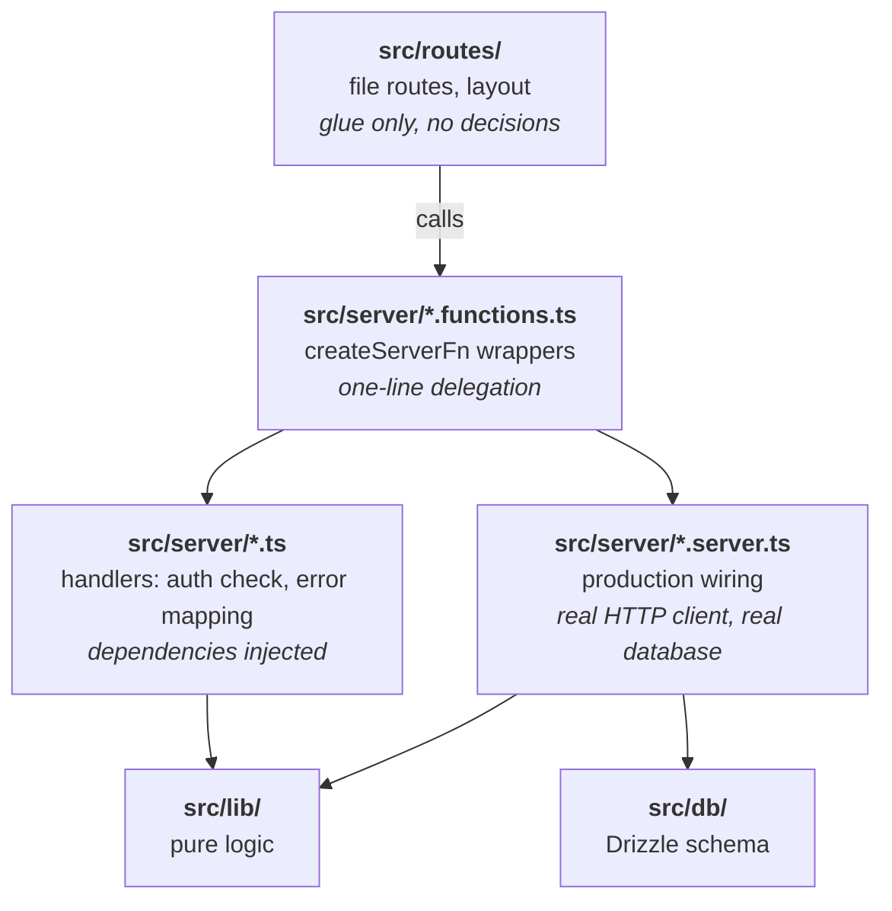

# Blueprint: Full-stack app

For apps where the server must own the data. The browser never talks to the database. Every read and write goes through a server function that checks who is asking.

Use this only when the [chooser page](README.md#web-app-or-full-stack-app) says so. It is more code than a [Web app](web-app.md), and its deploy pipeline is not proven yet.

**Reference repo:** `wish-list` (private; early stage, not deployed yet).

## The stack

| Layer | Choice | Status |
| --- | --- | --- |
| Framework | TanStack Start (React 19, Vite, Nitro server) | Adopted (one repo) |
| Routing and data | TanStack Router (file routes) + TanStack Query | Adopted (one repo) |
| Language | TypeScript strict | Adopted |
| Design | Cobalt + Tailwind v4 on Cobalt tokens | Adopted |
| Database | Supabase Postgres, reached **directly** with Drizzle. Supabase's Data API switched off | Adopted (one repo) |
| Migrations | Generated by `drizzle-kit` from `src/db/schema.ts`, committed | Adopted (one repo) |
| Auth | Supabase Auth or Better-Auth | **Open.** See [Data](../standards/data.md#auth) |
| Validation | zod, with `.validator()` on server functions | Adopted |
| Unit tests | Vitest, `node` environment, PGlite for the database, 100% | Adopted |
| End-to-end | Playwright, once there is UI to drive | Proposed |
| Host | Netlify | **Proposed, not proven.** Nothing on this blueprint has been deployed |

## Create it

```bash
npm create @tanstack/start@latest my-app
cd my-app
npm install @q-labs/cobalt @tanstack/react-query drizzle-orm pg zod
npm install -D drizzle-kit @electric-sql/pglite @types/pg tailwindcss @tailwindcss/vite \
  vitest @vitest/coverage-v8 eslint @eslint/js typescript-eslint eslint-plugin-react-hooks \
  @tanstack/eslint-plugin-query @tanstack/eslint-plugin-router globals husky lint-staged
```

Then copy the kit: [`kit/README.md`](../kit/README.md). Keep `vitest.config.ts` separate from `vite.config.ts`: the Start and Nitro plugins drive full builds and must not run under the test runner.

## Layers

Code is split by what it is allowed to know.



```
src/
  lib/            Pure logic. Dependencies passed in
  server/
    thing.ts              Handler: checks auth, maps errors. Tested
    thing.server.ts       Production wiring: the real client. Never imported by client code
    thing.functions.ts    createServerFn wrapper. Excluded from coverage: one line
  db/schema.ts    The single source of truth for the database
  routes/         File routes. Excluded from coverage: they only compose
  styles/app.css
  test/db.ts      PGlite with the real migrations applied
drizzle/          Generated SQL migrations. Committed
scripts/ci/       SQL the migrations job uses
docs/             architecture.md and friends
```

## Rules for this blueprint

| Rule | Why |
| --- | --- |
| **Server functions are public HTTP endpoints. Authenticate inside the handler** | A route guard only hides a page |
| **Routes contain no logic.** If a route grows a condition, extract it and test it | Routes are excluded from coverage because they only compose |
| **Never import `*.server.ts` from client code.** After touching server wiring, build and search the client bundle for server-only packages | Otherwise the database driver ships to the browser |
| **Loaders run on the server and the client.** Database access goes through server functions | |
| **Failures the UI should show are returned as data**: `{ ok: false, error: { code, message } }` | Only the code and message cross the wire |
| **Every table calls `.enableRLS()` and defines no policies**, and a migration revokes all privileges from the Data API roles | Three barriers: API off, no grants, RLS. A test fails for any table that forgets |
| **When one user must not see another's data, use two separate query functions**, not one query with an `if` | There is then nothing to strip out and nothing to forget. A test asserts the serialised payload |
| **After changing the schema, run `npm run db:generate` and commit the result** | CI fails if the schema and the migrations disagree |
| **A new server function fails closed** until auth is wired | Nobody can call it by accident |

## Environment variables

| Variable | Used by | Value on Supabase |
| --- | --- | --- |
| `DATABASE_URL` | The running server | Transaction pooler, port 6543, `?sslmode=verify-full` |
| `DIRECT_URL` | Migrations | Session pooler, port 5432, `?sslmode=verify-full` |
| `NODE_EXTRA_CA_CERTS` | Node, set in the host environment | Path to Supabase's CA certificate |

Details and the reasons: [Data](../standards/data.md#connection-strings).

## Verifying a change

Unit tests are necessary and not enough. The repo's `verify` skill holds the exact steps. In outline:

1. `npm run build`, then start the built server on a spare port.
2. Drive it in a real browser.
3. To exercise a server function, it needs a route that imports it, or it is in no bundle at all.
4. Search the client bundle for server-only code. Do this only with a real consumer in place; otherwise the check passes vacuously.
5. Apply the migrations to a real Postgres, twice.

## Deploying

Not built yet. This is the first piece of work for whoever ships the first app on this blueprint.

| Question | Starting point |
| --- | --- |
| Host | Netlify, to keep one host. Nitro has a Netlify output preset |
| Pipeline | The same three workflows from the kit. The artifact must carry the server function bundle as well as static files, so the artifact layout and the checks in `deploy-preview.yml` need adjusting |
| Database | `release.yml` runs `npm run db:migrate` before the deploy, as in every database repo |
| Runtime role | Connect as a dedicated least-privilege role rather than the table owner before launch |

When it works, update this page and the kit, and move "Host" to Adopted.

## Open questions

Tracked as issues in the reference repo, summarised in [Decisions](../decisions.md).

- Which auth system.
- Which host, and the pipeline for it.
- Release automation: the reference repo planned semantic-release; the standard is the version-bump-and-tag flow in [CI/CD](../standards/ci-cd.md#releases).
