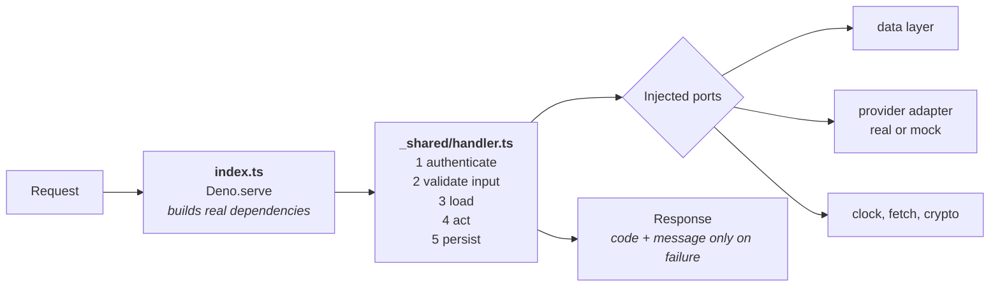

# Blueprint: Functions

For server-side code that has no interface of its own: an API endpoint, a webhook receiver, a scheduled job, a call to a model or a third-party service that needs a secret.

It usually lives inside a [Web app](web-app.md) or [Static site](static-site.md) repo, under `supabase/functions/`.

**Reference repo:** `easy-finances` (private). `Travel-OS` has the same kind of code on Vercel Functions, which is the pattern to move away from.

## The stack

| Layer | Choice | Status |
| --- | --- | --- |
| Runtime | **Supabase Edge Functions** (Deno) | Adopted (one repo). Proposed as the default |
| Language | TypeScript | Adopted |
| Logic | Pure handlers in `supabase/functions/_shared/`, dependencies injected | Adopted |
| Tests | Vitest in Node, 100% on `_shared/`. Entry files excluded | Adopted |
| Validation | zod on every input and every provider response | Adopted |
| Secrets | Supabase Function secrets | Adopted |
| Scheduled jobs | Supabase Cron (`pg_cron`) calling the function | Proposed. The one scheduled job today runs on Vercel Cron |
| Deploy | Supabase CLI: `supabase functions deploy`, run from `release.yml` | Proposed. The reference pipeline deploys the site and the migrations but not the functions, and the repo does not record how they are deployed today |

## Why Supabase Edge Functions

| Reason | |
| --- | --- |
| Next to the data | Same project as the database and auth. The user's session is verified for you |
| Secrets stay in one place | Not on a laptop, not in the web host, not in GitHub |
| Independent of the web host | Moving the site does not move the backend |
| Already proven | Five functions run this way, all with fully tested handlers |

Use a **Netlify Function** instead only when the endpoint must be on the site's own domain (a same-origin form handler, a feed URL people subscribe to) or the project has no Supabase at all.

## Folder layout

```
supabase/
  config.toml                  Per-function settings, e.g. verify_jwt
  functions/
    _shared/
      handler.ts               Pure orchestration: auth → load → do → persist
      data-layer.ts            The real adapter for the Supabase client
      providers/               One adapter per external service, plus a mock
      validation/              zod schemas
      errors/                  Typed errors and a sanitiser
      config/                  Reads secrets from the environment. Nowhere else does
    <function-name>/
      index.ts                 Deno.serve wrapper. A few lines. Excluded from coverage
    __tests__/
```

## The shape of a function



`index.ts` does three things: read configuration, construct the real ports, call the handler. It has no branches, which is why it is excluded from coverage. Everything that decides something is in `_shared/` and runs under Vitest in plain Node.

Deno imports such as `npm:zod@3` are mapped to the installed package with a Vitest alias, so one source file runs in both runtimes.

## Rules for this blueprint

| Rule | Why |
| --- | --- |
| **Authenticate first, inside the handler.** A user's JWT, a per-user token, or a shared secret header | The URL is public |
| **A function that turns JWT verification off says so in `config.toml`** and checks its own credential | Webhooks cannot send a Supabase JWT |
| **Tokens you issue are stored hashed**, shown once, and revocable | |
| **Never hard-code credentials or model names.** One config module reads them from the environment | |
| **Unset or unknown configuration falls back to the safe choice** | A typo in an environment name must not point test code at production |
| **With no credentials set, the mock adapter is used** | The whole flow runs locally without accounts |
| **Errors are sanitised.** Provider strings stay server-side | |
| **Make writes idempotent.** Hash the input, or use deterministic IDs, so a retry updates instead of duplicating | Webhooks and schedulers retry |
| **Writes that change live data are staged first** when they come from an outside source | A person approves the diff |
| **CORS is an allow-list**, not `*`, on anything a browser calls | |

## Triggers

| Trigger | How | Auth |
| --- | --- | --- |
| The app's own UI | `supabase.functions.invoke()` | The user's JWT |
| A webhook from another service | The function URL, registered with that service | Its signature or a shared secret; `verify_jwt = false` |
| A schedule | Supabase Cron calling the function | A secret header |
| A CLI or an agent | The function URL | A per-user token in a custom header |

## AI calls

Model calls are a function with a provider adapter. The full rules are on the [Agents](../standards/agents.md#ai-features-inside-our-apps) page: adapter interface, mock provider, zod-validated output, configuration-driven model name, idempotent requests.

## Moving off Vercel Functions

One repo has three endpoints under `api/` and a daily Vercel cron. To bring it to standard:

1. Move each handler's logic into `supabase/functions/_shared/`. The tests move with it and keep passing: they already inject `fetch` and the database client.
2. Add a thin `index.ts` per function.
3. Replace the Vercel cron with Supabase Cron.
4. Move the secrets to Function secrets.
5. An endpoint whose URL is given to outside systems (an email provider's webhook, a calendar subscription link) keeps its public address working: update the provider, or leave a redirect on the old path.
6. Only then move the site itself to Netlify.

This is the largest single migration in [Adoption](../adoption.md).

## A standalone API

A backend with no web app (a service other systems call) is the same blueprint in its own repo: the repo contract, `supabase/functions/`, a `supabase/migrations/` folder, and CI. Nothing in the tagged repos is one of these yet.
