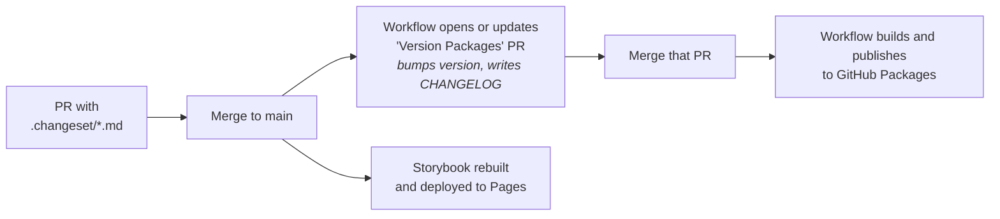

# Blueprint: Library

For code that other repos install: a component library, design tokens, shared utilities. It is versioned and published, not deployed.

**Reference repo:** `cobalt` (`@q-labs/cobalt`).

## The stack

| Layer | Choice | Status |
| --- | --- | --- |
| Build | Vite library mode: ESM and CommonJS output, type declarations from `vite-plugin-dts` | Adopted |
| Language | TypeScript strict | Adopted |
| Styles (UI libraries) | CSS Modules. Every value is a design token | Adopted |
| Unit tests | Vitest + Testing Library + user-event, jsdom, 100% | Adopted |
| Explorer and visual review | Storybook, with `play` functions as interaction tests | Adopted |
| Lint | ESLint flat config | Proposed. The reference repo has no linter yet |
| Versioning | Changesets | Adopted |
| Registry | GitHub Packages, scope `@q-labs` | Adopted |
| Docs host | Storybook on GitHub Pages | Adopted |
| Peer dependencies | React and React DOM as `peerDependencies` (`>=18`), never `dependencies` | Adopted |

## Folder layout

```
src/
  tokens/        CSS custom properties: primitives and semantic tokens
  typography/    Display, Heading, Body, Label, Mono
  atoms/         Button, Badge, Input, …
  molecules/
  organisms/
  templates/
  provider/      Injects tokens, sets data-theme
  index.ts       The public surface
scripts/         Export-map generation, CSS bundling
.changeset/      Pending version notes
.storybook/
examples/        A runnable consumer that proves the package works when installed
```

## A component is five files

```
atoms/MyComponent/
  MyComponent.tsx          implementation
  MyComponent.module.css   styles
  MyComponent.test.tsx     unit and interaction tests
  MyComponent.stories.tsx  one story per variant
  index.ts                 re-export
```

Then export it from the level's `index.ts` and from `src/index.ts`. The export map in `package.json` is generated; a pre-build check fails if it is stale.

## Three commits per component

Libraries hold the strictest form of the [workflow](../standards/workflow.md).

| Commit | Contains | Message |
| --- | --- | --- |
| Red | The test and the stories. The component does not exist, so the tests fail | `test(MyComponent): red — tests before implementation (#123)` |
| Green | The minimum implementation and styles that pass | `feat(MyComponent): green — minimal passing implementation (#123)` |
| Refactor | Clean-up. Tests still pass | `refactor(MyComponent): clean up implementation (#123)` |

## Rules for this blueprint

| Rule | Why |
| --- | --- |
| **CSS Modules only.** No Tailwind, no inline styles, no CSS-in-JS | A library must not force a styling tool on the apps that use it |
| **Tokens only.** `var(--accent-default)`, never `#2563EB` | Themes work by swapping tokens |
| **Dark is the default; light is `[data-theme="light"]`** | |
| **Components are presentational where possible**: no hooks, state or browser APIs unless the component needs them | They then render to plain HTML in Astro with no JavaScript |
| **Every variant prop is exercised in a test, and has a story** | |
| **Every PR that changes behaviour, API or tokens includes a changeset** | No changeset, no release |
| **Removing or renaming an export or a token is a major version** | Consumers break otherwise |
| **Ship a full stylesheet and per-component entry points** | Apps choose between one import and the smallest bundle |
| **Never hand-edit generated sections** of the README or the export map | A workflow rewrites them |

## Versioning

| Bump | When |
| --- | --- |
| patch | Bug fixes, internal refactors with no API change |
| minor | New components or props, backwards-compatible additions |
| major | Removed or renamed exports, breaking prop changes, token renames |

## Release pipeline



CI on every PR: typecheck, tests with coverage, the library build, and the Storybook build. A broken Storybook fails the PR.

## Consuming a library

In the consuming repo:

1. `.npmrc` (committed): `@q-labs:registry=https://npm.pkg.github.com`
2. A token with `read:packages` in the user-level `~/.npmrc`, and as `COBALT_PACKAGES_TOKEN` in CI.
3. `npm install @q-labs/cobalt`

See [UI and Cobalt](../standards/ui.md).

## After a release

Consumers do not update themselves. When a library ships a minor or major version, open a Task in each consuming repo (or let Dependabot do it, once adopted). Three apps are on two different Cobalt versions today.

## Non-UI libraries

A shared utilities or config package follows the same blueprint without Storybook, CSS and the component rules: Vite library mode, Vitest at 100%, Changesets, GitHub Packages. Create one only when two repos already contain the same code. Copying once is cheaper than a package.
