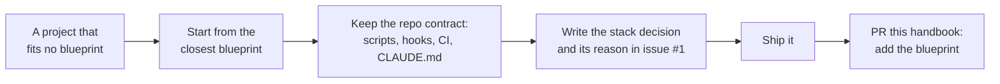

# Not built yet

Kinds of project that none of the surveyed repos is. Everything on this page is **Proposed**: a starting recommendation with its reasoning, not a tested setup. The first real project of each kind writes the actual blueprint.

## Mobile app

| Step | Recommendation | Why |
| --- | --- | --- |
| 1. Try the web first | Build it as a [Web app](web-app.md) that installs to the home screen (a PWA: a manifest and a service worker) | One codebase, the proven pipeline, no app-store review. Covers most "I need it on my phone" needs |
| 2. If it needs the device | **Expo** (React Native) with TypeScript and Supabase | Reuses React, TypeScript, zod, TanStack Query and the Supabase client. Cobalt's tokens carry over as values; its web components do not |
| 3. If it needs deep platform features | Native Swift | Only when Expo cannot reach the API. A separate skill set and toolchain |

Signals for step 2: push notifications that must be reliable, background work, the camera or sensors beyond what the browser offers, or an app-store listing as a business requirement.

What stays the same for any of these: the [repo contract](../standards/repo-contract.md), issue first, test first, Vitest for the pure logic, Supabase for data, Edge Functions for server-side code.

Not decided: the build and release pipeline (Expo's hosted builds or GitHub Actions), and how Cobalt's tokens are exported for native use.

## Browser extension

Start from the [Web app](web-app.md) stack: Vite, React, TypeScript, Cobalt for any popup or options page. Keep the logic in pure modules so it is tested outside the browser. The manifest, packaging and store submission are not decided.

## Desktop app

Build it as a web app first. If it must be a desktop program, that is a decision for an issue, with the reason written down.

## Documentation site

| Kind | Use | Status |
| --- | --- | --- |
| A handbook or internal docs | Markdown in a repo, read on GitHub, with a no-build viewer on GitHub Pages. This repo is the example | Adopted (this repo) |
| A component library's docs | Storybook on GitHub Pages | Adopted (Cobalt) |
| Public product documentation with many pages, search and versions | An Astro docs theme, following [Static site](static-site.md) | Proposed |

Why this handbook has no build step: its main readers are agents, who read the Markdown files directly. A build would add dependencies to keep current and nothing they need.

## An app with payments, e-commerce, or a CMS

These are features, not project types. Use the [Web app](web-app.md) or [Static site](static-site.md) blueprint and add the service:

| Feature | Approach |
| --- | --- |
| Payments | The provider's hosted checkout, called from an [Edge Function](functions.md). The secret key lives in Function secrets. Never handle card details yourself |
| Content editing by non-developers | A Git-based CMS on a static site (one site uses Sveltia CMS) |
| Email | A transactional email service called from an Edge Function |
| File uploads | Supabase Storage, with policies like any table |

Each of these is a new dependency and usually a new vendor, so each starts with an issue.

## The rule for anything new

A blueprint is earned by a project that shipped. Until then, it is a paragraph on this page.
