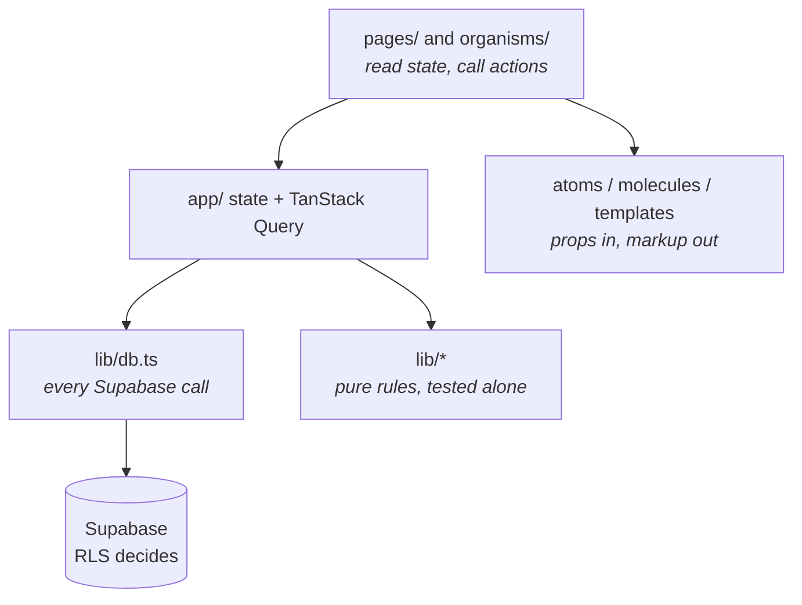

# Blueprint: Web app

For interactive apps: dashboards, trackers, planners, tools people sign in to. The app runs in the browser and talks to Supabase directly. Database policies decide who can see what.

This is the default for anything with a login. Choose [Full-stack app](full-stack-app.md) only for the reasons on the [chooser page](README.md#web-app-or-full-stack-app).

**Reference repos:** `easy-finances` (private; the reference deploy pipeline and Edge Function layer), `Travel-OS` (TypeScript, Cobalt, Playwright).

## The stack

| Layer | Choice | Status |
| --- | --- | --- |
| Framework | React 19 + Vite | Adopted. Both reference repos are still on React 18 |
| Language | TypeScript strict | Adopted (one of the two reference repos is still JavaScript) |
| Routing | TanStack Router | Decided by the owner (D3). One repo uses React Router 6 and stays there |
| Server data | TanStack Query | Decided by the owner (D3) |
| Design | Cobalt components, Tailwind v4 on Cobalt tokens | Each half is in use in one web app; neither has both yet |
| Data | `supabase-js` from the browser, row-level security on every table | Adopted |
| Auth | Supabase Auth | Adopted |
| Server-side code | Supabase Edge Functions. See [Functions](functions.md) | In use (one repo) |
| Validation | zod | Adopted |
| Unit tests | Vitest + Testing Library, jsdom, 100% | Adopted |
| Component explorer | Storybook 10 (`@storybook/react-vite`). A story file for every component | Decided by the owner (D26). No app has it yet |
| Code documentation | JSDoc on every export in `src/`, enforced by `eslint-plugin-jsdoc` | Decided by the owner (D27). Not checked in any repo yet |
| End-to-end | Playwright against the built app | In use (one repo) |
| Host | Netlify, prebuilt, with a single-page-app redirect | In use (one repo). One app is still on Vercel |

## Create it

```bash
npm create vite@latest my-app -- --template react-ts
cd my-app
npm install @q-labs/cobalt @supabase/supabase-js @tanstack/react-router @tanstack/react-query zod
npm install -D tailwindcss @tailwindcss/vite vitest @vitest/coverage-v8 jsdom \
  @testing-library/react @testing-library/user-event @testing-library/jest-dom \
  @playwright/test eslint @eslint/js typescript-eslint eslint-plugin-react-hooks eslint-plugin-jsdoc globals \
  husky lint-staged
npm create storybook@latest
```

Then copy the kit: [`kit/README.md`](../kit/README.md).

## Folder layout

```
src/
  main.tsx          Entry. Excluded from coverage: it only mounts the app
  app/              Router, providers, app-level state
  components/
    atoms/          One element. Props only
    molecules/      A few atoms. Props only
    organisms/      A feature section. May read app state
    templates/      Page frames. Props only
    pages/          One per route
  lib/              Pure logic: domain rules, formatters, parsers, mappers
    supabase.ts     The client
    db.ts           Every read and write, in one place
    clients/        One file per external API, each taking an injected fetch
    types.ts
  styles/app.css    Tailwind + Cobalt + the token mapping
  test/setup.ts
supabase/
  migrations/       SQL
  functions/        Edge Functions (see the Functions blueprint)
e2e/                Playwright specs
public/_redirects   /*  /index.html  200
.storybook/         Storybook config. Import the app's stylesheet in preview.ts
```

Each component sits in its own folder: `Name.tsx`, `Name.test.tsx`, `Name.stories.tsx` and `index.ts`.

## Where things go



| Rule | Why |
| --- | --- |
| **Views hold no business logic.** Rules live in pure functions in `lib/` | They are tested without rendering anything |
| **Every component has stories**, one per variant and state | Every state can be reviewed without the app's data. CI fails when Storybook does not build |
| **Every export has a JSDoc comment** | The contract is readable at the definition and on hover. The lint fails without it |
| **Only organisms and pages touch app state.** Atoms, molecules and templates take props | Small pieces stay reusable and trivially testable |
| **All Supabase calls go through `lib/db.ts`** (or one file per domain) | One place to mock, one place to read what the app asks the database |
| **Every table has RLS on, with explicit policies** | The browser holds the publishable key. Policies are the security |
| **Every function in `lib/db.ts` returns a result**: `{ ok: true, data }` or `{ ok: false, error: { code, message } }`. The screen shows "saved" only after the server confirms, and a failed read is an error state, not an empty list. Proposed ([D25](../decisions.md)) | A swallowed error looks like a save. An empty list looks like "nothing here" |
| **External APIs take an injected `fetch`** | Tests never touch the network |
| **Anything needing a secret runs in an Edge Function** | The browser bundle is public |
| **No global store** unless an issue justifies it | Query for server data, React state for the rest |

## Environment variables

| Variable | Where | Note |
| --- | --- | --- |
| `VITE_SUPABASE_URL` | Browser | Public |
| `VITE_SUPABASE_ANON_KEY` | Browser | Public by design |
| Feature flags, `VITE_*` | Browser | Public. A deployment flag pairs with a per-user flag in the database |

In CI these are GitHub Actions **variables**, passed to the build step. Secrets for third-party services are Supabase Function secrets, never `VITE_*`.

## Patterns worth copying

| Pattern | What it is | Where it exists |
| --- | --- | --- |
| Demo mode | With no Supabase variables set, the app runs on sample data. Good for reviews and first-time setup | One web app |
| Stage, review, apply | Imported data lands in a staging table as a batch. The user sees the diff and approves it before anything is written to live tables | One web app |
| End-to-end auth bypass | A dev-only flag set by Playwright's web server lets specs reach signed-in routes. Gated on the dev build so it cannot ship | `Travel-OS` |
| Layer guard tests | A test that reads the import graph and fails when a component imports from a level above, or rebuilds something Cobalt provides | `Travel-OS` |
| Keyless enrichment | Public APIs that need no key are called straight from the browser and fail silently | `Travel-OS` |

## Deploying

The standard pipeline: [CI/CD](../standards/ci-cd.md). Two things are specific to a web app.

- **Single-page-app redirect.** Add `public/_redirects` containing `/*  /index.html  200`. It is copied into `dist/`, so the prebuilt upload carries its own routing rule.
- **Security headers.** Add `public/_headers` from the kit and write the app's Content-Security-Policy. See [Front-end checklist](../standards/frontend-checklist.md).
- **Migrations.** `release.yml` applies pending files before the deploy. See [Data](../standards/data.md#migrations).

## When this blueprint stops fitting

| Need | Do |
| --- | --- |
| A webhook, scheduled job or model call | Add [Functions](functions.md). Still a web app |
| A bulk import or maintenance tool | Add a [CLI](cli-and-scripts.md) under `scripts/` that reuses `lib/` |
| A rule a policy cannot safely express, or server-rendered pages | Move to [Full-stack app](full-stack-app.md). TanStack Router and Query carry over |
