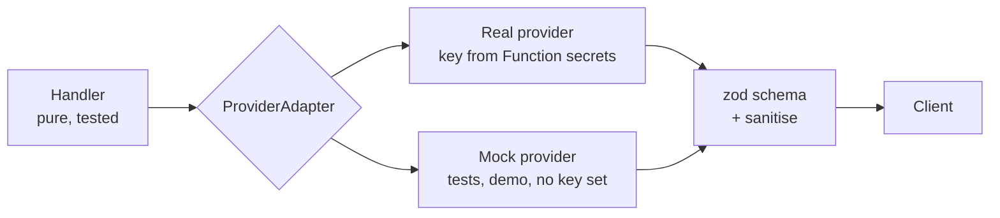

# Agents

Most code in these repos is written with coding agents (Claude Code first, also Codex, Copilot and Gemini). An agent is only as good as what the repo tells it. This page says what every repo tells it, and where.

## One rulebook per repo: `CLAUDE.md`

| File | Role |
| --- | --- |
| `CLAUDE.md` | **The rulebook.** The only place rules are written |
| `AGENTS.md` | One line: "Read `CLAUDE.md`." For agents that look for this file |
| `.github/copilot-instructions.md` | The same one line, for Copilot |
| `.claude/skills/<name>/SKILL.md` | Step-by-step recipes the agent loads on demand |
| `docs/architecture.md` | The why. Linked from the rulebook, not repeated in it |

**Pointers, not copies.** Three repos keep a second copy of their rules for Copilot, and one of those copies never mentions the design system its repo now requires. A pointer cannot go stale.

### What `CLAUDE.md` contains

Start from the template: [`kit/common/CLAUDE.template.md`](../kit/common/CLAUDE.template.md). Keep it short enough to read in full. In this order:

1. **What this repo is**, its stack in one line, and which [blueprint](../blueprints/README.md) it follows.
2. **Commands**: the exact scripts, including how to run a single test.
3. **Project layout**: a tree with one line per folder.
4. **The rules**: issue first, test first, 100% coverage, commit format, docs parity. The template carries these so the repo is self-contained even when the agent cannot reach this handbook.
5. **Architecture rules** specific to this repo, each with its reason. Mark the ones that must never break.
6. **Deviations from the standard**: what differs and why.
7. **Environment gotchas**: things that cost someone an hour once.

Write rules as instructions with reasons. "Never import `*.server.ts` from client code: it ships the database driver to the browser" beats "be careful with imports".

**The repo's `CLAUDE.md` wins** where it and this handbook disagree. The disagreement is then a deviation to list, or a change to propose here.

## What every agent must do

These are in the template. They are the same in every repo.

1. **Open or find the issue before writing code.**
2. **Write the failing test first.** See it fail for the right reason.
3. **Reach 100% coverage on touched files before moving on.**
4. **Never skip, disable or delete a test to get green.** Never lower a threshold.
5. **File out-of-scope discoveries as issues.** Do not fix them in this PR.
6. **Prove it at runtime.** Run the built app and say what you saw. Green CI is not evidence.
7. **Update the docs in the same PR** when behaviour, structure or setup changes.
8. **No new dependency without discussion.**
9. **No schema changes through a dashboard or an MCP tool.** Migrations go in the PR.
10. **Never put a secret in a file, a commit or the chat.**
11. **Review UI changes against the [Front-end checklist](frontend-checklist.md).** Fix Critical and High findings the PR introduced; file the rest.
12. **Say what you did not do.** Skipped steps, failing tests and unverified claims are reported, not hidden.

## Skills

A skill is a folder with a `SKILL.md` that an agent loads when the task matches. Use one when a procedure has steps that are easy to get wrong.

| Skill | Every repo? | What it holds |
| --- | --- | --- |
| `verify` | Yes, for anything that runs | How to build, start and drive this app to prove a change works: ports, commands, how to stop it, what the sandbox cannot do. Template: [`kit/common/claude-skill-verify/SKILL.template.md`](../kit/common/claude-skill-verify/SKILL.template.md) |
| Front-End Checklist skills, or its MCP server | Anything with an interface | How to review code and pages against the checklist. See [Front-end checklist](frontend-checklist.md#agent-review) |
| Vendor skills (for example Supabase's) | Where relevant | Pinned in a lock file. **The repo's own conventions win** where they differ, and `CLAUDE.md` says which |
| Task skills | As needed | A recurring, multi-step job specific to the repo |

## Cloud sessions

A cloud session is Claude Code running on a fresh Linux machine instead of your computer. Each session starts from a saved **environment**: network rules, plain variables, secrets, and a setup script.

| Rule | Detail |
| --- | --- |
| One shared environment for all repos | Call it **Everyday**. Not one per repo |
| Everyday holds **no keys** | A secret on an environment is usable by every session in it, including a compromised package running during tests |
| Keys go in a second environment, picked only when needed | **Everyday + keys**. Delete the secret when the job is done |
| Tools needed in every session go in the environment's setup script | It runs once and is cached |
| Anything one repo needs goes in that repo | Its README "Cloud sessions" section and its `CLAUDE.md` |
| Node version | The setup script installs the standard Node and a `with-node` helper that runs a command on the version in `.nvmrc`. With every repo on the same major, this is one install |
| Playwright | Never run `playwright install`. Use the pre-installed Chromium via `PLAYWRIGHT_CHROMIUM_EXECUTABLE_PATH` |
| Postgres | Installed but stopped. Start it per session, or use PGlite |
| A blocked host | A settings change for the owner. Not something to work around |
| Production migrations, logins to third-party sites | Not from a cloud session |

The environment's setup script and its documentation live in the `setup-scripts` repo. To let cloud sessions read this handbook, add `qiheme.github.io` to the environment's allowed domains.

Each repo's README has a short **Cloud sessions** table: what works as-is, and what extra this repo needs.

## AI features inside our apps

When an app itself calls a model (parsing an email, drafting a plan), the code follows one shape.

| Rule | Why |
| --- | --- |
| Calls run server-side, in an Edge Function | The key never reaches the browser |
| Behind a provider adapter interface, with a deterministic **mock** | The test suite needs no key and no network |
| Provider and model name come from configuration (Function secrets) | Changing models is a settings change, not a code change |
| Output is validated with zod and sanitised before it reaches the client | Model output is untrusted input |
| Requests are idempotent: hash the input, return the stored result on a repeat | No double spend |
| Low-confidence results are flagged for review, not applied | |
| Default provider | Claude, through `@anthropic-ai/sdk` |

In a cloud session, never set `ANTHROPIC_API_KEY` or the other `ANTHROPIC_*` variables in the environment: the coding agent reads those for its own connection.

## Keeping agents aligned across repos

- New repo: copy the template, fill it in, list deviations.
- The standard changed: update this handbook first, then each repo's `CLAUDE.md` in its own PR.
- A rule an agent keeps breaking is a rule that is unclear. Rewrite it with its reason; do not just repeat it louder.
