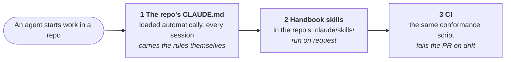
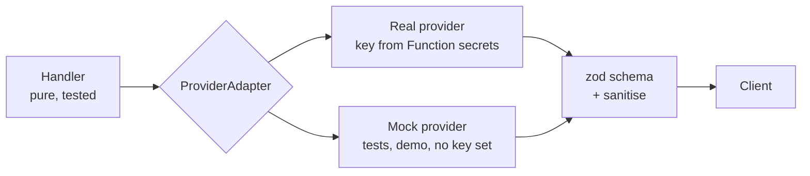

# Agents

Most code in these repos is written with coding agents (Claude Code first, also Codex, Copilot and Gemini). An agent is only as good as what the repo tells it. This page says what every repo tells it, and where.

## One rulebook per repo: `CLAUDE.md`

| File | Role |
| --- | --- |
| `CLAUDE.md` | **The rulebook.** The only place rules are written |
| `AGENTS.md` | One line: "Read `CLAUDE.md`." For agents that look for this file |
| `.github/copilot-instructions.md` | The same one line, for Copilot |
| `.claude/skills/<name>/SKILL.md` | Step-by-step recipes the agent loads on demand |
| `docs/architecture.md` | The why. Linked from the rulebook, not repeated in it |

**Pointers, not copies.** Three repos keep a second copy of their rules for Copilot, and one of those copies never mentions the design system its repo now requires. A pointer cannot go stale.

### What `CLAUDE.md` contains

Start from the template: [`kit/common/CLAUDE.template.md`](../kit/common/CLAUDE.template.md). Keep it short enough to read in full. In this order:

1. **What this repo is**, its stack in one line, and which [blueprint](../blueprints/README.md) it follows.
2. **Commands**: the exact scripts, including how to run a single test.
3. **Project layout**: a tree with one line per folder.
4. **The rules**: issue first, test first, 100% coverage, commit format, docs parity. The template carries these so the repo is self-contained even when the agent cannot reach this handbook.
5. **Architecture rules** specific to this repo, each with its reason. Mark the ones that must never break.
6. **Deviations from the standard**: what differs and why, as a table. The conformance check reads it (see below).
7. **Environment gotchas**: things that cost someone an hour once.

Write rules as instructions with reasons. "Never import `*.server.ts` from client code: it ships the database driver to the browser" beats "be careful with imports".

**The repo's `CLAUDE.md` wins** where it and this handbook disagree. The disagreement is then a deviation to list, or a change to propose here.

## What every agent must do

These are in the template. They are the same in every repo.

1. **Open or find the issue before writing code.**
2. **Write the failing test first.** See it fail for the right reason.
3. **Reach 100% coverage on touched files before moving on.**
4. **Never skip, disable or delete a test to get green.** Never lower a threshold.
5. **File out-of-scope discoveries as issues.** Do not fix them in this PR.
6. **Prove it at runtime.** Run the built app and say what you saw. Green CI is not evidence.
7. **Update the docs in the same PR** when behaviour, structure or setup changes.
8. **No new dependency without discussion.**
9. **No schema changes through a dashboard or an MCP tool.** Migrations go in the PR.
10. **Never put a secret in a file, a commit or the chat.**
11. **Review UI changes against the [Front-end checklist](frontend-checklist.md).** Fix Critical and High findings the PR introduced; file the rest.
12. **Say what you did not do.** Skipped steps, failing tests and unverified claims are reported, not hidden.

## How an agent meets the handbook

Three layers. Each one works without the others, so a gap in one does not leave an agent with nothing.



| Layer | What it is | How it is triggered | What it guarantees |
| --- | --- | --- | --- |
| 1. Rulebook | The repo's own `CLAUDE.md`, made from the kit template. It states the rules in full, so it works even when the agent cannot reach this handbook | Nothing to do. Claude Code loads it at the start of every session | Day-to-day work follows the standard: issue first, test first, the gates, the commit format |
| 2. Skills | Two skills that live in this handbook and are copied into each repo: `handbook-audit` and `handbook-new-project` | Ask in plain words ("audit this repo against the handbook", "start a new web app here"), or type `/handbook-audit` or `/handbook-new-project` | An audit or a new project is one request, done the same way each time |
| 3. CI | [`audit.mjs`](../skills/handbook-audit/scripts/audit.mjs), the script the audit skill runs, as a step in `ci.yml` | Every pull request | A repo cannot drift from the contract without a red check |

### Auditing a repo

Say **"audit this repo against the handbook"**, or type `/handbook-audit`.

| Request | What the agent does |
| --- | --- |
| `/handbook-audit` | Runs the conformance script, reads the repo's listed deviations, compares it with its blueprint, reports the gaps in priority order, and **logs each one as a GitHub issue**. Changes no files |
| `/handbook-audit full` | The same, plus a read of the code (testability, data, security, UI), the Front-End Checklist, and a run of the gates |
| `/handbook-audit fix` | Audits, then closes the gaps the repo's own way: an issue, then a pull request, copying from the kit |

**Every finding becomes an issue.** Work starts with an issue, so an audit does not end with a list in a chat. For each required rule that is not met, the skill files one Task issue in the repo, written in the standard form (What, Why now, Done when, Parent issue, Effort estimate), all attached as sub-issues to one tracking issue. The script writes the text, so the issues read the same in every repo.

| Line in the report | Becomes |
| --- | --- |
| `FAIL` | One issue per rule, a sub-issue of the tracking issue |
| `TODO` | Listed in the tracking issue. Not filed: a proposal is not work until it is decided |
| `DEV` | Listed in the tracking issue with the repo's reason |

Running the audit again does not create duplicates. A finding's title ends with its rule id, so the skill finds the issue it filed before. It reopens one that has come back, and closes one whose rule is now met, with the evidence. A security weakness in a public repository is the one thing it does not file in the open.

The script on its own, with no agent:

```bash
node .claude/skills/handbook-audit/scripts/audit.mjs . --all       # the report
node .claude/skills/handbook-audit/scripts/audit.mjs . --issues    # the issue drafts, as JSON
```

It needs only Node. It checks about thirty rules a machine can verify (required files, script names, the Node pin, hooks, CI, lint and test configuration, the deploy pipeline, framework versions) and prints the handbook page for each one it finds broken.

| It prints | When | Fails the run? |
| --- | --- | --- |
| `FAIL` | A rule this handbook marks Adopted or In use is not met | Yes |
| `TODO` | A rule this handbook marks Proposed is not met | No. A proposal is not binding until it is decided |
| `DEV` | A rule is not met, and the repo's `CLAUDE.md` lists it as a deviation with a reason | No |

**A repo that differs on purpose says so, and the check accepts it.** Add a row to the Deviations table in the repo's `CLAUDE.md`, with the rule id in backticks and the reason:

```markdown
| Rule | Standard | This repo | Reason | Tracking issue |
| --- | --- | --- | --- | --- |
| `netlify-pipeline` | Netlify, built on Actions | Not deployed yet | The first deploy is its own piece of work | #19 |
```

The list is checked too: a row with no reason, an id the script does not know, or a deviation that is no longer true each fail the run. So the table cannot hide a gap by accident, and it cannot go stale.

The script reports facts. The skill adds the judgement the script cannot make.

### Starting a new project

In an empty repository, say **"start a new project from the handbook"**, or type `/handbook-new-project`, with what you are building. The agent picks the blueprint (asking one question if the request does not settle it), opens the first issue, scaffolds, copies the kit, fills in `CLAUDE.md`, proves the gates fail when they should, and runs the audit until nothing required is failing. It finishes with a pull request and a checklist of the settings only the owner can make.

An empty repository has no skills yet. Either attach this handbook's repository to the session and say "follow `skills/handbook-new-project/SKILL.md` in the handbook", or install the skills first (below).

### Getting the skills into a repo

Cloud sessions load skills only from the repository itself (`.claude/skills/`), not from a user's home folder. So the skills are copied into each repo and committed, the same way vendor skills already are:

```bash
npx skills add qiheme/handbook --agent claude-code --skill '*' --copy
```

That writes `.claude/skills/handbook-audit/` and `.claude/skills/handbook-new-project/` and records them in `skills-lock.json`. `npx skills update` refreshes them when the handbook changes. Copying the two folders by hand does the same.

Two other routes, for sessions where a repo has no skills yet:

| Route | Reaches | Set up |
| --- | --- | --- |
| A pointer in the user-level `CLAUDE.md` | Every session, any repo, including cloud sessions (the environment's setup script writes it) | One paragraph naming this handbook and the two skills. Not done yet: it is a change to the `setup-scripts` repo |
| Skills on the claude.ai account | Every cloud session | Upload the two skill folders once in the account's settings |

### Running the check in CI

The kit's [`ci.yml`](../kit/workflows/ci.yml) runs the script when the skill is present. This is the part that keeps a repo conforming after the day it was set up. **Proposed:** it becomes a required check once a repo has closed its gaps or listed them as deviations; until then it would fail every pull request.

## Skills

A skill is a folder with a `SKILL.md` that an agent loads when the task matches. Use one when a procedure has steps that are easy to get wrong.

| Skill | Every repo? | What it holds |
| --- | --- | --- |
| `handbook-audit`, `handbook-new-project` | Yes | Audit a repo against this handbook; start a new one from a blueprint. They live in this repository under [`skills/`](../skills/handbook-audit/SKILL.md). See above |
| `verify` | Yes, for anything that runs | How to build, start and drive this app to prove a change works: ports, commands, how to stop it, what the sandbox cannot do. Template: [`kit/common/claude-skill-verify/SKILL.template.md`](../kit/common/claude-skill-verify/SKILL.template.md) |
| Front-End Checklist skills, or its MCP server | Anything with an interface | How to review code and pages against the checklist. See [Front-end checklist](frontend-checklist.md#agent-review) |
| Vendor skills (for example Supabase's) | Where relevant | Pinned in a lock file. **The repo's own conventions win** where they differ, and `CLAUDE.md` says which |
| Task skills | As needed | A recurring, multi-step job specific to the repo |

## Cloud sessions

A cloud session is Claude Code running on a fresh Linux machine instead of your computer. Each session starts from a saved **environment**: network rules, plain variables, secrets, and a setup script.

| Rule | Detail |
| --- | --- |
| One shared environment for all repos | Call it **Everyday**. Not one per repo |
| Everyday holds **no keys** | A secret on an environment is usable by every session in it, including a compromised package running during tests |
| Keys go in a second environment, picked only when needed | **Everyday + keys**. Delete the secret when the job is done |
| Tools needed in every session go in the environment's setup script | It runs once and is cached |
| Anything one repo needs goes in that repo | Its README "Cloud sessions" section and its `CLAUDE.md` |
| Node version | The setup script installs the standard Node and a `with-node` helper that runs a command on the version in `.nvmrc`. With every repo on the same major, this is one install |
| Playwright | Never run `playwright install`. Use the pre-installed Chromium via `PLAYWRIGHT_CHROMIUM_EXECUTABLE_PATH` |
| Postgres | Installed but stopped. Start it per session, or use PGlite |
| A blocked host | A settings change for the owner. Not something to work around |
| Production migrations, logins to third-party sites | Not from a cloud session |

The environment's setup script and its documentation live in the `setup-scripts` repo. To let cloud sessions read this handbook, add `qiheme.github.io` to the environment's allowed domains (the handbook is served at `qiheme.github.io/handbook/`). Reading it from GitHub (`raw.githubusercontent.com`) needs nothing extra.

Each repo's README has a short **Cloud sessions** table: what works as-is, and what extra this repo needs.

## AI features inside our apps

When an app itself calls a model (parsing an email, drafting a plan), the code follows one shape.



| Rule | Why |
| --- | --- |
| Calls run server-side, in an Edge Function | The key never reaches the browser |
| Behind a provider adapter interface, with a deterministic **mock** | The test suite needs no key and no network |
| Provider and model name come from configuration (Function secrets) | Changing models is a settings change, not a code change |
| Output is validated with zod and sanitised before it reaches the client | Model output is untrusted input |
| Requests are idempotent: hash the input, return the stored result on a repeat | No double spend |
| Low-confidence results are flagged for review, not applied | |
| Default provider | Claude, through `@anthropic-ai/sdk` |

In a cloud session, never set `ANTHROPIC_API_KEY` or the other `ANTHROPIC_*` variables in the environment: the coding agent reads those for its own connection.

## Keeping agents aligned across repos

- New repo: copy the template, fill it in, list deviations.
- The standard changed: update this handbook first, then each repo's `CLAUDE.md` in its own PR.
- A rule an agent keeps breaking is a rule that is unclear. Rewrite it with its reason; do not just repeat it louder.
