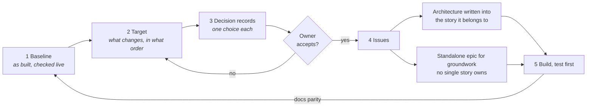

# Architecture

How we write down what a system is made of, what it should become, and why. Three kinds of page, kept in the repo beside the code.

**Status: Proposed** ([D22, D23](../decisions.md)). Being tried in `Travel-OS`, where the first set is in review. Until a second repo follows, treat this page as the recommended shape, not as established practice.

## The three documents

| Document | Path | Answers | Changes |
| --- | --- | --- | --- |
| **As built** | `docs/architecture.md` | What is here today, and where does each part run? | In the same pull request as the code it describes |
| **Target** | `docs/architecture/<issue>-<slug>.md` | What changes for this epic, and in what order? | Written before the epic's first story. Left as a record when the epic closes |
| **Decision record** | `docs/decisions/<NNNN>-<slug>.md` | Why this and not that? | Never rewritten once accepted. A change of mind is a new record |

The reason for three: they go stale at different speeds. What is built changes every week. A plan is right for one epic. A decision should still read true in two years.

## When each is required

| Situation | Write |
| --- | --- |
| Any deployed repo | `docs/architecture.md` |
| An epic that adds or changes a table, server-side code, the host, an outside service or a runtime dependency | A target page and its decision records, **before the first story starts** |
| One story that does one of those | A decision record, and the as-built page updated in the same pull request |
| A change to layout, copy or styling | Nothing |

A plan written after the first migration is a description, not a plan. The cheap moment to find that two stories want the same data in different shapes is before either is built.

## The as-built page

Start from [`kit/common/docs/architecture.template.md`](../kit/common/docs/architecture.template.md). In this order, so the same thing is always in the same place:

| # | Section | Holds |
| --- | --- | --- |
| 1 | Checked | The date, the commit, and which live sources were read |
| 2 | The system in one picture | People, the app, each service, and the arrows between them |
| 3 | Where each part runs | One row per part: runtime, how it reaches the data, source folder |
| 4 | Code layout and layers | The import rules, and what enforces each one |
| 5 | State and the write path | How a change gets from a tap to the database, and what happens when it fails |
| 6 | Data model | Tables, keys, policies, and what is stored as JSON |
| 7 | Server functions | Trigger, how the caller proves itself, reads, writes, outside calls |
| 8 | Outside services and what they cost | One row per service, including the free ones |
| 9 | Build, checks and delivery | Every gate, and what does **not** have one |
| 10 | Production today | What is live, from which commit |
| 11 | Gaps against this handbook | Each with an issue number |
| 12 | Not verified | What could not be checked, why, and what would settle it |

| Rule | Why |
| --- | --- |
| **Check it, do not remember it.** Read the code, the host's deployment record and the database. Say what was read and when | A baseline written from memory records what the author believes. The first one written this way found a production build seven months behind `main` |
| **"Not verified" is a section, not an omission** | A gap the reader can see is a task. A gap the reader cannot see is a surprise |
| **Every outside service has a cost line**: what it costs today and what would make it cost money. Free services are listed too | Free tiers have conditions, such as non-commercial use, that only matter on the day the project changes |
| **Every gap has an issue.** If the audit already filed one, link it; do not open a second | A list of gaps with no owner is a list of complaints |
| **A security weakness is never written in the page.** State the rule the target will meet, and report the weakness privately | [Security](security.md#reporting-a-security-problem). A public repo's documents are public |
| **Diagrams are Mermaid, in the page** | They are reviewed in the pull request like the text around them |

## The target page

Start from [`kit/common/docs/architecture-target.template.md`](../kit/common/docs/architecture-target.template.md).

| # | Section | Holds |
| --- | --- | --- |
| 1 | Status | Proposed, or accepted and by which pull request |
| 2 | The plan on one page | One row per change: what, why, which issue, which decision record |
| 3 | Target picture | The same diagram as the baseline, as it will be |
| 4 | What changes, layer by layer | Today, target, story |
| 5 | Data | What goes where, new tables, the rules they follow, changes to existing data |
| 6 | The write path | As it will be |
| 7 | Server code | Each function: trigger, credential, what the epic changes in it |
| 8 | Environments | Local, preview, production: which code, which data, who can reach it |
| 9 | Story map | Each story that changes something underneath, and what it needs first |
| 10 | Order | Waves, and what must land before what |
| 11 | Running cost | What each change does to the bill, including "nothing" |
| 12 | Risks and what is not verified | Each with the issue that settles it |

| Rule | Why |
| --- | --- |
| **Follow this handbook, and say where the plan departs from it.** A departure is a decision record and a row in the repo's deviations | [The standard changes here, by PR](../CLAUDE.md) |
| **Name the decisions the plan leans on that are still Proposed or Open here** | The owner should see what a "yes" to the plan also says yes to |
| **Size the groundwork honestly, next to the features it supports** | Groundwork that outweighs the feature is a reason to re-order, and the owner can only do that if they can see it |
| **No dates.** Order and blockers only | [Writing style](../CLAUDE.md) |

## From target to issues

| Kind of work | Where it goes |
| --- | --- |
| Architecture one experience needs | **Into that story**: an "Architecture" heading, the extra steps to test, and the new blockers |
| Groundwork no single experience owns: pipelines, migrations, the data layer, moving a host | **A standalone epic** with its own Task stories |
| A gap an audit already filed | Linked from the epic. Not duplicated |

A story that says "save an expense" and a separate ticket that says "create the expenses table" will be built by different people at different times, and the table will not fit the story. Putting the table in the story keeps one owner for one outcome. Groundwork is different: nobody's story should wait on "move the host".

Every architecture line in a story is paired with a step to test, like any other acceptance criterion. "Run the migration twice: the second run changes nothing" is a step. "Use an idempotent migration" is not.

## Decision records

Start from [`kit/common/docs/decision.template.md`](../kit/common/docs/decision.template.md). One page, six parts: status, context, decision, runner-up, consequences, reopen when.

| Rule | Why |
| --- | --- |
| **One decision per record** | A record that decides three things cannot be superseded cleanly |
| **Name the runner-up and why it lost** | It is the first thing the next person will suggest |
| **Say what would reopen it** | A decision with no exit condition gets relitigated on opinion |
| **A new runtime dependency always has a record** | "No new dependency without discussion" needs somewhere for the discussion to live |
| **Open as Proposed, in the pull request that needs it.** The owner's approval of that pull request makes it Accepted | An agent proposes. It does not accept |
| **Never edit an accepted record.** Write a new one that says which it replaces | The history of why is the point |
| Number in order, four digits, and keep an index in `docs/decisions/README.md` | |

Decision records are for one repo. A choice that should hold in every repo is a change to this handbook, with a row in [Decisions](../decisions.md).

## Two things a target usually has to settle

Both came out of the first use of this page, and both now have a proposed rule:

- **A table or a JSON column**, and what one user action may write: [Data](data.md#a-table-or-a-json-column).
- **What the app shows when a write fails**: [Web app](../blueprints/web-app.md#where-things-go).

Two more are still open: how an app and its Edge Functions share code (O9) and what data a preview uses (O10). See [Decisions](../decisions.md#open).
