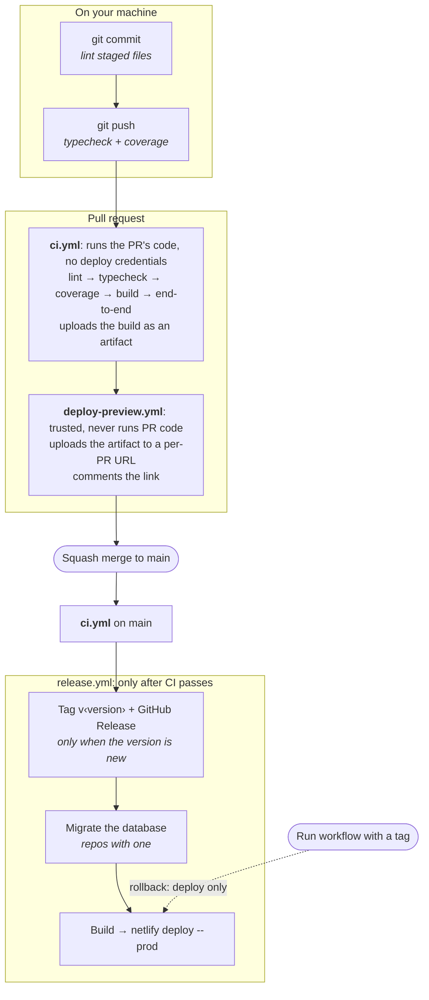

# CI/CD

How code is checked, previewed, released and hosted. One pipeline shape for every deployed repo.

## The pipeline

The three workflow files are in the kit: [`ci.yml`](../kit/workflows/ci.yml), [`deploy-preview.yml`](../kit/workflows/deploy-preview.yml), [`release.yml`](../kit/workflows/release.yml).

## Gates

| Gate | When | Runs | Why there |
| --- | --- | --- | --- |
| lint-staged | pre-commit | `eslint --fix --max-warnings 0` on staged files | Fast. Never blocks the red commit of a TDD cycle |
| Quality | pre-push | `npm run typecheck && npm run test:coverage` | Needs green tests, so it cannot run on commit |
| CI | every PR, every push to `main` | lint → typecheck → coverage → build → end-to-end, plus the migrations job | The gate that cannot be skipped |
| Preview | every PR | The built site on its own URL | A person looks at it before merge |
| Release | merge to `main`, after CI passes | Tag, migrate, deploy | A commit that fails CI is never tagged or deployed |

## Hosting: Netlify, built on GitHub Actions

**Netlify hosts. GitHub Actions builds. Netlify never builds.** The site is uploaded prebuilt with the Netlify CLI (`netlify deploy --no-build --dir dist`).

| Why | |
| --- | --- |
| Tests gate the deploy | Netlify's own build would deploy code that CI is still checking |
| It works for private repos in any org | Netlify's Git integration could not reach one of ours |
| One place for build configuration | The workflow file, in the repo, reviewed like code |
| Rollback is a button | Re-run the release workflow with an older tag |

One-time setup per site:

1. Create the Netlify project. **Stop builds** (Project configuration → Build & deploy → Continuous deployment), or leave it unlinked from Git.
2. Create a Netlify personal access token.
3. In the GitHub repo, add the secrets and variables in the table below.
4. Optional: add required reviewers to the `production` environment to put a click in front of every production deploy.

Until the Netlify secrets exist, previews skip with a notice and production deploys fail with a pointer to the README.

Server-rendered apps (TanStack Start) follow the same shape, but the artifact holds more than `dist/`. That pipeline is not proven yet: see [Full-stack app](../blueprints/full-stack-app.md#deploying).

### What uses GitHub Pages

Only documentation of public repos: Cobalt's Storybook and this handbook. Not apps.

### Leaving Vercel

Two repos still deploy to Vercel. New work does not. To move a static site: remove the Vercel adapter and add the three workflows. To move an app that uses Vercel Functions or Vercel Cron: move that code first. See [Functions](../blueprints/functions.md#moving-off-vercel-functions).

## Previews are split in two, on purpose

A PR's code runs `npm ci` and the build. A compromised dependency could read any secret those steps can see. So:

| | `ci.yml` on the PR | `deploy-preview.yml` |
| --- | --- | --- |
| Trust | Untrusted: runs the PR's code | Trusted: always runs the copy on `main` (`workflow_run`) |
| Credentials | Read-only token. No deploy secrets | Holds the Netlify token |
| Does | Builds, tests, uploads `dist/` as an artifact | Downloads the artifact, checks it holds only build output, uploads it as a draft deploy |
| Runs PR code? | Yes | Never. No checkout, no `npm` inside the artifact |

A draft deploy to an alias (`pr-<number>--<site>.netlify.app`) cannot touch production. Fork PRs get no preview. `workflow_run` workflows only fire once the file exists on `main`, so previews start working after the pipeline's own PR merges.

## Releases

### Apps and sites

1. **Bump the version in the PR**: `npm version <patch|minor|major> --no-git-tag-version`.
   - patch: fixes and tweaks. minor: new features, new pages, schema changes. major: breaking changes.
2. **Merge.** `release.yml` waits for CI on `main`, then tags `v<version>` and creates a GitHub Release, but only if that tag is new. Notes are generated from the merged PRs.
3. **Deploy runs on every merge**, bump or not. Production always matches `main`.
4. **Rollback:** Actions → Release & Deploy → Run workflow → enter an older tag. Code only. It never rolls the database back, which is safe because migrations only add things.

An app that shows its own changelog to users also keeps a changelog entry per version, and CI checks that the version, the changelog and the tag agree.

### Libraries

Changesets. Every PR that changes behaviour, API or tokens adds a changeset (`npx changeset`). Merging opens a "Version Packages" PR. Merging that publishes to GitHub Packages. See [Library](../blueprints/library.md).

## The migrations job

Repos with a database have a second CI job. It starts a throwaway Postgres 17 and:

1. Creates stand-ins for the roles Supabase ships, so the migrations have something real to act on.
2. Applies every migration to the empty database.
3. Applies them again and checks that nothing changes.
4. Drizzle repos: regenerates from the schema and fails if a new file appears (the schema changed without a migration).

In production, `release.yml` applies pending migrations **before** the build and deploy. If a migration fails, nothing is deployed and the current version keeps running. The database secret is given to that one step only. Rules for writing migrations: [Data](data.md#migrations).

## Secrets and variables

Same names in every repo. Set under Settings → Secrets and variables → Actions.

| Name | Kind | What it is |
| --- | --- | --- |
| `COBALT_PACKAGES_TOKEN` | Secret | A token with `read:packages`, so `npm ci` can install `@q-labs/cobalt`. The built-in `GITHUB_TOKEN` cannot read another owner's packages |
| `NETLIFY_AUTH_TOKEN` | Secret | Netlify personal access token |
| `NETLIFY_SITE_ID` | Secret | The Netlify project ID |
| `DIRECT_URL` | Secret, `production` environment | Database connection for migrations: Supabase **session pooler**, port 5432. GitHub's runners are IPv4-only and cannot reach the direct connection |
| `VITE_*`, `PUBLIC_*` | **Variables**, not secrets | Build-time values that end up in the public bundle anyway: the Supabase URL, the publishable (anon) key, feature flags |

Never put a real secret in a `VITE_*` or `PUBLIC_*` name. Anything with those prefixes is shipped to every browser. More: [Security](security.md).

## Workflow conventions

| Convention | Why |
| --- | --- |
| `node-version-file: .nvmrc` | One place to change Node |
| `cache: npm` and `npm ci` | Fast, reproducible installs |
| `permissions:` set per workflow, least privilege. `contents: read` unless it must write | A leaked token can do less |
| `persist-credentials: false` on checkouts that run untrusted code | The token is not left on disk |
| `HUSKY: '0'` in CI | `npm ci` would install hooks; a tag push would run them |
| Pin the Netlify CLI to an exact version | A CLI release cannot break deploys on its own |
| `concurrency` cancels superseded PR runs. Production deploys are serialised and never cancelled mid-upload | |
| The deploy skips itself if `main` has moved on | Runs can finish out of order; an old commit must not overwrite a newer one |
| Secrets are scoped to the single step that needs them | `npm ci` and the build never see the database URL |
| Never rely on a check that could pass vacuously | A failed lookup must stop the job, not read as "nothing to do" |

## Dependency updates

**Proposed.** Dependabot, weekly, with minor and patch updates grouped into one PR per repo. Major updates arrive one at a time and are treated as a Task. Config: [`kit/common/.github/dependabot.yml`](../kit/common/.github/dependabot.yml).
