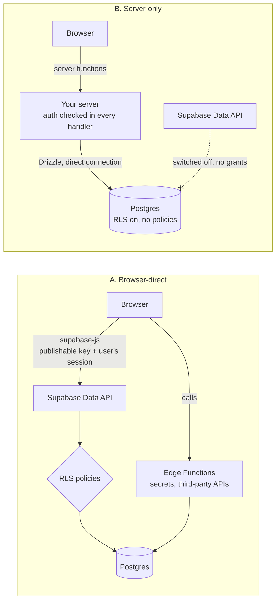

# Data

Supabase is the backend for everything that stores data. Supabase is managed Postgres plus sign-in, file storage, realtime updates and Edge Functions (small server-side programs).

There are two ways to reach the data. Pick one per project.

## Two access patterns

| | **A. Browser-direct** | **B. Server-only** |
| --- | --- | --- |
| Blueprint | [Web app](../blueprints/web-app.md) | [Full-stack app](../blueprints/full-stack-app.md) |
| Who talks to the database | The browser, with `supabase-js` and the publishable key (older projects call it the anon key) | Only your server, with Drizzle over a direct connection |
| What protects the data | Row-level security (RLS) policies: rules in the database that decide which rows each signed-in user may see | The server's own code. Supabase's Data API is switched off |
| Server-side logic | Supabase Edge Functions | Server functions in the app |
| Schema lives in | SQL files in `supabase/migrations/` | `src/db/schema.ts` (Drizzle), with generated SQL in `drizzle/` |
| Status | Adopted (two repos) | In use (one repo) |

### Which one

Use **A** unless one of these is true. Then use **B**.

- A rule cannot be safely expressed as a policy. Example: one user must never learn something about rows another user created in their own list.
- A mistake in a single policy would be a serious leak, and you want more than one barrier.
- The app needs server-rendered pages, or the server must fetch things on the user's behalf.

## Rules for every table

| Rule | Why |
| --- | --- |
| Row-level security is **enabled on every table** | A new Supabase table is otherwise readable through the Data API with the public key |
| Pattern A: write explicit policies, scoped `to authenticated`, keyed on `auth.uid()` | |
| Pattern B: **no policies at all**, and a migration that revokes every privilege from the API roles | With RLS on and no policy, the API roles see nothing. Three barriers, so one mistake does not expose data |
| Index every foreign key column | Joins and cascades. A test enforces it in Drizzle repos |
| `timestamptz` for times, `numeric` for money, `text` over `varchar(n)` | |
| Use a `CHECK` for rules the database can own | A `CHECK` passes when its expression is `NULL`. Write `col IS NOT NULL AND …` |
| A table only the server may read (stored tokens, staging data) gets RLS on with no policies, in either pattern | Only the service role can reach it |
| A new function in `public` must `REVOKE EXECUTE … FROM PUBLIC` in its own migration | Postgres grants `EXECUTE` to everyone by default, and the API roles inherit it |
| When a policy calls a helper function, grant `EXECUTE` to the roles the policy applies to, and keep the helper in a schema the API does not expose | Postgres checks `EXECUTE` against the role running the query |

## A table or a JSON column

**Proposed** ([D24](../decisions.md)). Being tried in `Travel-OS`.

| Store it as | When |
| --- | --- |
| **A table, one row per thing** | Items are added one at a time, edited on their own, pointed at by something else, counted or queried, or must never be lost to an edit somewhere else. Money and evidence always qualify |
| **A JSON column on the row it belongs to** | It is saved and read only with that row and has no life of its own: how one expense is split, a snapshot taken at a moment |

| Rule | Why |
| --- | --- |
| In a browser-direct app, **one user action is one write to one row** | `supabase-js` cannot run a transaction across tables. Two writes can half-succeed, and the user sees a save that did not fully happen |
| If one action must change two tables, it goes through **one database function** | The function is the transaction |
| A list kept in a JSON column gives **every item a stable id**. Never address an item by its position | Positions change when anything is inserted or removed, and every later item looks new |
| **Write the column you changed**, not the whole row | A row of several JSON documents written whole lets a change in one overwrite a change in another made on a second device |
| A row the browser creates carries **an id made in the browser** | A retry after a lost reply hits the same key instead of creating a second row |

## Migrations

A migration is a file that changes the database's structure. The rules are the same in both patterns.

| Rule | Why |
| --- | --- |
| Schema changes ship as migration files **in a PR**. Never through the dashboard, the SQL editor or an MCP tool | Reviewable, repeatable, and they pick up the RLS and grants rules |
| **Only add things.** To remove or rename, ship two PRs: first stop using it, then drop it | Migrations run before the new code deploys, while the old code is still live. A rollback never reverts the schema |
| Never edit a migration that has merged. Add a new one | Production has already run it |
| No `BEGIN`/`COMMIT` inside the file; nothing that cannot run in a transaction | The runner wraps each file in one |
| CI applies every migration to a throwaway Postgres, twice | A broken migration fails the PR, not the deploy |
| Production migrations run automatically in `release.yml`, before the deploy | A failed migration stops the deploy |

How the files are made:

| Pattern | Create a migration | Apply | Status |
| --- | --- | --- | --- |
| A. Browser-direct | Hand-written SQL in `supabase/migrations/`, named by the Supabase CLI: `supabase migration new <name>` | `npm run db:migrate`, which wraps `supabase db push --db-url "$DIRECT_URL"` | Proposed for new repos. Not yet proven in a repo |
| B. Server-only | Edit `src/db/schema.ts`, then `npm run db:generate`. Commit the generated `drizzle/` files | `npm run db:migrate` | In use (one repo) |

One existing repo uses its own naming (`YYYYMMDD_NNN_name.sql`) and its own runner, and requires every file to be safe to apply twice. That is an accepted variant: it works, it is tested, and renaming applied history is risk for no gain. New repos use the table above.

## Connection strings

Supabase offers several. Using the wrong one causes confusing errors.

| Variable | Used by | Which Supabase string |
| --- | --- | --- |
| `DATABASE_URL` | The running server (pattern B) | **Transaction pooler**, port 6543 |
| `DIRECT_URL` | Migrations | **Session pooler**, port 5432 (IPv4, works from GitHub's runners), or the direct string |

- The transaction pooler has no prepared statements. Never give a `pg` query a `name`.
- Hosted URLs carry `?sslmode=verify-full`, and Node trusts Supabase's certificate through `NODE_EXTRA_CA_CERTS` (set in the environment, not in `.env`). With no `sslmode`, `node-postgres` sends everything unencrypted. Never fix a certificate error by turning verification off.
- Percent-encode a password that contains URL characters.
- Run migrations as `postgres`.

## Environment variable names

| Name | Where it is read | Public? |
| --- | --- | --- |
| `VITE_SUPABASE_URL` | Browser | Yes |
| `VITE_SUPABASE_ANON_KEY` | Browser | Yes. It is designed to be public; RLS protects the data |
| `SUPABASE_URL` | Server and functions | Yes |
| `SUPABASE_SERVICE_ROLE_KEY` | Server and functions only | **No.** It bypasses RLS |
| `DATABASE_URL`, `DIRECT_URL` | Server, migrations | **No** |

Astro sites use `PUBLIC_` where Vite apps use `VITE_`.

## Auth

| Pattern | Standard | Status |
| --- | --- | --- |
| A. Browser-direct | **Supabase Auth**: magic link, password, and OAuth providers as needed | Adopted |
| B. Server-only | Supabase Auth or Better-Auth | **Open.** Not decided for this pattern. Until it is, new server-only projects should use Supabase Auth, so there is one sign-in system to operate |

Whichever is used: add every redirect URL (local and production) to the allow-list, and keep the session check inside every server handler.

## Local development and tests

| Need | Use |
| --- | --- |
| Unit and schema tests | **PGlite**: real Postgres in-process, real migrations applied. No setup |
| A local database | Plain Postgres in Docker: `docker run -d -p 5432:5432 -e POSTGRES_PASSWORD=postgres postgres:17` |
| The full Supabase stack (Auth, Storage, Studio) | Supabase CLI: `supabase start` |
| Typed queries in pattern A | `supabase gen types typescript` |

## The Supabase MCP server

Read-only: advisors, logs, inspecting tables. It must not apply schema changes or run writes against a production project. Use a scoped access token, not a full-account one.
