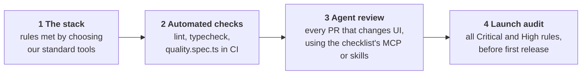

# Front-end checklist

Everything with an interface is built and reviewed against the **Front-End Checklist** ([frontendchecklist.io](https://frontendchecklist.io)). It is the shared definition of "done properly" for HTML, CSS, JavaScript, performance, accessibility, SEO, security and images.

We use someone else's list on purpose. It is maintained, it is prioritised, and agents can read it directly.

**Status: Proposed.** No repo has been audited against it yet. See [Decisions](../decisions.md).

## What it is

| | |
| --- | --- |
| Size | 386 rules in 11 categories |
| Priorities | Critical, High, Medium, Low |
| Browse | [frontendchecklist.io/rules](https://frontendchecklist.io/rules). Each rule has its own page with the reason, the fix and how to verify it |
| For agents | An MCP server at `mcp.frontendchecklist.io`, and installable skills |
| Source | The [`thedaviddias/Front-End-Checklist`](https://github.com/thedaviddias/Front-End-Checklist) repository |

Numbers on this page were read from that repository on 2026-11-21. The list grows, so check the source for the current count.

## What is required

| Priority | Rules | Our rule |
| --- | --- | --- |
| **Critical** | 19 | Must pass before a PR merges. These are the site-breaking, legal and security rules |
| **High** | 134 | New work meets them in the PR that adds it. A project meets all that apply before it launches |
| **Medium** | 208 | The default in review. Skip one with a reason |
| **Low** | 25 | Optional |

**A rule that does not apply needs no paperwork.** A rule about video captions does not apply to a site with no video. A rule you choose not to follow is different: list it in the repo's `CLAUDE.md` under "Deviations", with the reason.

## How we follow it: four layers

| Layer | When | What happens | Catches |
| --- | --- | --- | --- |
| 1. The stack | Always | Following a [blueprint](../blueprints/README.md) meets a rule without anyone thinking about it | HTTPS, minified and split bundles, strict TypeScript, design tokens |
| 2. Automated checks | Every push and PR | ESLint, `tsc`, and [`quality.spec.ts`](../kit/e2e/quality.spec.ts) in the Playwright run | Document basics, images, mixed content, console errors, a large share of accessibility |
| 3. Agent review | Every PR that changes what users see | The agent reviews the changed files against the checklist and fixes or files what it finds | Semantics, focus handling, naming, anything that needs reading the code |
| 4. Launch audit | Before the first production release, and after a redesign | Every Critical and High rule that applies, checked on the preview URL. The result is written into the launch issue | Performance, SEO, headers, cross-page problems |

## Category by category

What each category asks for, what already covers it, and what is still on a person or an agent.

| Category | Critical / High / Medium / Low | Met by the stack | Checked automatically | Still needs review |
| --- | --- | --- | --- | --- |
| HTML | 3 / 9 / 12 / 1 | Astro and Vite templates set the doctype, charset and viewport | Doctype, charset first in `<head>`, viewport, `lang`, unique IDs, integrity hashes on external scripts | Semantic elements, form validation, captions |
| CSS | 0 / 11 / 15 / 6 | Cobalt tokens are CSS custom properties. Tailwind removes unused CSS and ships a reset. The build minifies | Pinch zoom is not disabled. Contrast, through axe | Visible focus styles, relative units, animations on `transform` and `opacity` |
| JavaScript | 1 / 12 / 12 / 1 | TypeScript strict, ES modules, zod at every boundary. Vite minifies and splits bundles | ESLint: no `eval`, no `var`, no `any`. No console errors or uncaught exceptions | Error handling, memory leaks, debounced handlers |
| Performance | 1 / 23 / 18 / 2 | Netlify serves from a CDN with compression. Astro ships no JavaScript by default. [`_headers`](../kit/netlify/_headers) caches fingerprinted files for a year | Nothing yet | Largest contentful paint, layout shift, interaction delay, page weight, fonts, third-party scripts |
| Accessibility | 9 / 26 / 56 / 4 | Cobalt components | axe at WCAG 2.2 A and AA: names, labels, contrast, ARIA validity, landmarks, heading order | Keyboard walk-through, focus order, screen reader pass, reflow at 400% zoom |
| SEO | 0 / 19 / 71 / 4 | The static-site blueprint: sitemap, robots, canonical URLs, feed | Title, one `<h1>`, meta description, canonical URL, `robots.txt`, sitemap. The static-site suite also checks internal links | Structured data, content quality, redirects |
| Security | 4 / 10 / 6 / 2 | Netlify serves HTTPS and redirects HTTP. Secrets follow [Security](security.md). [`_headers`](../kit/netlify/_headers) sets HSTS, frame, content-type, referrer and permissions headers | No mixed content | A Content-Security-Policy for each app, cookie flags, dependency audit |
| Images | 1 / 15 / 5 / 4 | | `alt` on every image, explicit width and height, no broken images | Modern formats, responsive sizes, lazy loading, compression |
| Testing | 0 / 7 / 6 / 0 | Vitest at 100%, Playwright end-to-end, coverage thresholds ([Testing](testing.md)) | Accessibility testing, through this spec | Other browsers, real devices, error monitoring |
| Privacy | 0 / 2 / 3 / 0 | No third-party trackers by default | | Privacy policy link and cookie notice on public sites |
| Internationalisation | 0 / 0 / 4 / 1 | | `lang` is set | `Intl` for dates, numbers and currency |

## The automated part

One Playwright spec, in the kit: [`kit/e2e/quality.spec.ts`](../kit/e2e/quality.spec.ts). Copy it next to the other specs and list the routes.

| Test | Checklist rules |
| --- | --- |
| Document basics | HTML5 doctype, UTF-8 charset first in `<head>`, responsive viewport, pinch zoom allowed, `lang`, unique IDs |
| Title, heading and search basics | Page title, exactly one `<h1>`, meta description, absolute canonical URL |
| Images | `alt` attribute, width and height, no broken images |
| Loads cleanly and safely | No console errors, no plain-`http` requests, integrity hash on external scripts and styles |
| Accessibility | axe-core, WCAG 2.2 levels A and AA |
| Site files | `robots.txt` exists and names a sitemap that exists |

- Checks are soft assertions, so one run reports every broken rule.
- An app behind a login sets `INDEXABLE = false`, which skips the search-engine checks.
- It needs one new dev dependency, `@axe-core/playwright`.
- It was run against a good page (all pass) and a deliberately bad page (20 distinct failures reported).

It is a floor. Passing it does not mean the checklist is met; it means the cheap mistakes are gone.

## Agent review

The checklist is built for agents. Two ways in:

| | How | Use for |
| --- | --- | --- |
| MCP server | Connect `https://mcp.frontendchecklist.io`. Its tools include `review_code`, `search_rules`, `get_checklist_rules`, `get_workflow` and `audit_url` | Reviewing changed files in a PR. Auditing a preview URL |
| Skills | `npx skills add frontendchecklist/skills` | A reusable audit workflow inside the repo, pinned in the skills lock file like other vendor skills |

What an agent does on a PR that changes UI:

1. Review the changed components and pages against the checklist. Name the checklist in the request; some clients only load a tool when asked for it.
2. Fix every Critical and High finding that the PR introduced.
3. File findings in code the PR did not touch as issues. Do not fix them here.
4. Say in the PR what was reviewed and what was found. "No findings" is a result.

**Cloud sessions:** add `frontendchecklist.io` and `mcp.frontendchecklist.io` to the environment's allowed domains. Until then, agents there can read the full rule list from the source repository's README.

Not verified: the MCP server and the skills install were not run when this page was written, because the session could not reach the site. The tool names above come from the source repository.

## Launch audit

Before a project's first production release, and after a redesign:

1. Run `audit_url` (or a browser audit such as Lighthouse) on the preview URL.
2. Walk the site by keyboard only. Then once with a screen reader.
3. Check the response headers on the preview URL against the Security rules.
4. Go through every remaining Critical and High rule that applies.
5. Record the result in the launch issue: passed, fixed, or filed with an issue number.

## Known gaps against High rules

Places where the standard itself does not yet meet the checklist. Each is in [Decisions](../decisions.md).

| High rule | Where we are |
| --- | --- |
| Test across all major browsers | End-to-end tests run in Chromium only |
| Integrate real-time error monitoring in production | No repo has error monitoring |
| Core Web Vitals and page weight | Not measured in CI. Checked by hand at launch |
| Implement a content security policy | The kit ships a starting point, not a finished policy. Each app writes its own |
| Audit dependencies for known vulnerabilities | Depends on Dependabot, which is itself Proposed |
| Test with screen readers | Manual, at launch only |

## Where we differ from the checklist

| Checklist rule | What we do | Why |
| --- | --- | --- |
| Lint CSS and SCSS files (Medium) | No CSS linter | Styling is Tailwind utilities on Cobalt tokens; there is little hand-written CSS to lint. Cobalt itself is the exception and may add one |
| Google Consent Mode, Google Tag Manager rules | Not applicable by default | The standard includes no third-party tags. They apply the moment one is added |
| Image sprites, progressive JPEG (Low) | Not followed | Superseded by modern formats and HTTP/2 |

## This handbook follows it too

The viewer at <https://qiheme.github.io> was put through the same process. Running `quality.spec.ts` against it found four real problems, all fixed:

| Found | Fix |
| --- | --- |
| Two `<h1>` elements on every page | The sidebar title is no longer a heading |
| An active link at 3.94:1 contrast in dark mode | A lighter accent on dark backgrounds |
| A focusable button nested inside a button | One control, reachable by keyboard |
| Wide tables that could scroll but not by keyboard | A focusable scroll region around each table |

It also has no inline script or style, deferred scripts, every third-party file pinned to an exact version with an integrity hash, a Content-Security-Policy, and a readable message if the viewer cannot load. The diagram library (3.5 MB) is fetched only on pages that have a diagram.

Still open for the viewer: a page with a diagram is over the checklist's page-weight guide (about 1 MB compressed), and the search-engine rules are not pursued because the handbook is reference material, not a site meant to rank.

## Per blueprint

| Blueprint | What applies |
| --- | --- |
| [Static site](../blueprints/static-site.md) | Everything. SEO, images, performance and privacy matter most here |
| [Web app](../blueprints/web-app.md), [Full-stack app](../blueprints/full-stack-app.md) | Everything for public pages. Behind the login, the SEO category mostly does not apply; accessibility, security and performance fully do |
| [Library](../blueprints/library.md) | Accessibility, CSS and JavaScript rules, per component. Run axe in the component tests or Storybook |
| Functions, CLI | The security and JavaScript rules that concern server code |
