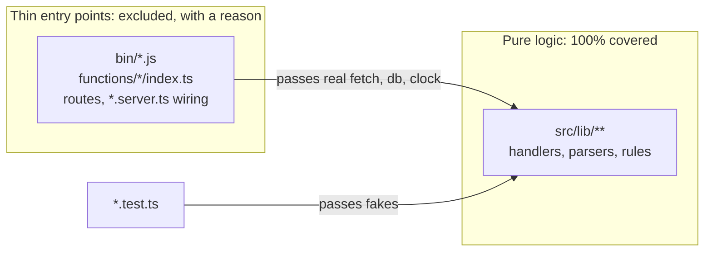

# Testing

Tests are how we know a change works, and how an agent knows it is finished. The bar is the same in every repo.

## The rules

| Rule | Detail |
| --- | --- |
| Runner | Vitest, with `@vitest/coverage-v8` |
| Coverage floor | **100%** lines, branches, functions and statements |
| The gate | `npm run test:coverage`. Plain `npm test` does not enforce thresholds |
| Where it runs | Pre-push hook and CI. Not pre-commit |
| Order | Test first: red, green, refactor ([Workflow](workflow.md)) |
| Types | `npm run typecheck` is a separate gate. Vitest strips types without checking them |
| End-to-end | Playwright (Chromium) against the **built** output, for anything with pages |

## Write code that can be tested

This is the idea the 100% floor depends on. Without it the floor is misery; with it, it is routine.

**Logic is pure and takes its dependencies as arguments.** The HTTP client, the database client, the clock, the file system and the model provider are passed in. Production wiring supplies the real ones. Tests supply fakes. Nothing needs a browser, a server or a network to run.



```ts
// src/lib/weather.ts — pure: fetch is an argument
export async function getForecast(city: string, deps: { fetch: typeof fetch }) { … }

// production wiring (one line, no branches)
getForecast(city, { fetch })

// test
getForecast('Lagos', { fetch: fakeFetch })
```

## Coverage exclusions

Excluding a file is allowed only for these reasons, and the reason is written as a comment next to the exclusion in the Vitest config.

| May be excluded | Because |
| --- | --- |
| Entry points with no branches: `bin/**`, Edge Function `index.ts`, `main.tsx` | They only construct real dependencies and hand off |
| Framework glue: file routes, the router factory, `createServerFn` wrappers | They only compose. If one grows a condition, extract it and test it |
| Generated files | Not hand-written |
| Types-only files, pure re-export barrels, static fixtures | Nothing executes |
| Stories and config files | Not shipped logic |

Everything else is covered. **When a coverage gap appears, ask what behaviour is untested and add that test.** Do not exclude the file.

A single line that truly cannot be reached in a test gets `/* v8 ignore next */` and a comment explaining why.

## Lessons already paid for

- **A passing test proves nothing until you have seen it fail.** After a green run, break the code on purpose (remove a constraint, flip a condition) and check a test goes red.
- **Write the red test against a stub**, so it fails on behaviour and not on a missing import.
- **Check your fake is faithful.** `new Response('x')` quietly adds a `content-type` header, which once made a "no content type" test lie.
- **Give tests an explicit "today".** Any rule that depends on the date takes the date as an argument.
- **Never let a test touch the network.** Inject `fetch`.

## Which environment

| Code under test | Vitest `environment` |
| --- | --- |
| Pure logic, server code, CLIs, Edge Function handlers | `node` (the default in full-stack and CLI repos) |
| React components | `jsdom` (the default in web apps and libraries) |
| A lone component test in a `node` repo | Opt in per file: `// @vitest-environment jsdom` |

Component tests use Testing Library and `@testing-library/user-event`. Test what the user sees and does, not implementation details. Every variant prop of a library component is exercised.

## Database tests

- Test against a real Postgres engine, not a mocked ORM. Constraints, cascades and row-level security are database behaviour; a mock cannot catch a missing one.
- Use **PGlite** (Postgres compiled to run in-process) with the real migrations applied. No Docker needed, and it works in cloud sessions.
- PGlite boots slowly when many test files start at once. Raise `testTimeout` and `hookTimeout`; do not lower them later.
- CI also applies the migrations to a real Postgres service, twice. See [CI/CD](ci-cd.md#the-migrations-job).
- Write tests for the rules the database owns: every table has row-level security on, every foreign key is indexed, the wrong role is refused.

## End-to-end tests

| Rule | Why |
| --- | --- |
| Run against the built output (`npm run build`, then a preview server) | Tests what ships, not the dev server |
| Start a fresh server on its own port; never reuse a running one | A stale build gives false results |
| Desktop and one mobile viewport | The layout changes below the breakpoint |
| Fail on any console error or uncaught exception | Catches what assertions miss |
| `reducedMotion: 'reduce'` | No waiting on animations |
| Trace on first retry, screenshot on failure, report uploaded as a CI artifact | Debuggable failures |
| Visual snapshots are optional. If used, regenerate deliberately and commit the images in the same PR | |
| Include [`quality.spec.ts`](../kit/e2e/quality.spec.ts): document basics, images, clean loading, and an axe accessibility scan on every route | It automates the checkable part of the [Front-end checklist](frontend-checklist.md). Proposed |
| Chromium only, for now | The checklist asks for all major browsers. Adding Firefox and WebKit is an open decision |

Apps behind a login use a dev-only bypass flag that the Playwright web server sets. It must be gated on the dev build so it cannot exist in production.

**In cloud sessions:** never run `playwright install`. Use the pre-installed Chromium. See [Agents](agents.md#cloud-sessions).

## Per blueprint

| Blueprint | Unit | End-to-end | Notes |
| --- | --- | --- | --- |
| Static site | Pure helpers in `src/lib/`, and any browser script, loaded into jsdom | Every page loads, nav, forms, SEO files, no dead internal links | Keep logic out of `.astro` frontmatter so it can be tested |
| Web app | Logic, components, Edge Function handlers | Core flows | |
| Full-stack app | Logic, handlers, schema (PGlite) | Core flows, once there is UI | Also grep the client bundle for server-only code |
| Library | Every component and variant | Storybook `play` functions | Storybook must build in CI |
| Functions | Handlers, adapters, validation | A single smoke call after deploy | Entry `index.ts` excluded |
| CLI | Argument parsing, commands, every decision | A dry run | `bin/` excluded |
| Shell | `bats` unit tests on pure functions, `shellcheck` on everything | | Never against the real machine |
